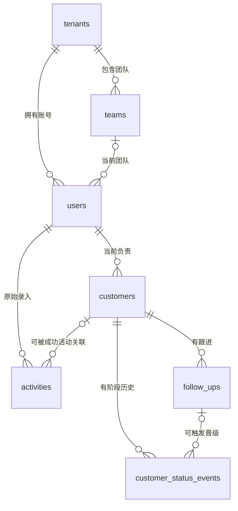

# 货代销售工作台 · 数据库设计与复核

> 这是保留的 v1.1 设计基线。已完成内容及验证范围见 [实施状态](../implementation-status.md)，实际代码以本仓库为准。

版本：v1.1 · 2026-11-11。设计基线，尚未部署。配套：[后端文档](backend-technical-design.md)、[前端文档](frontend-technical-design.md)、[实施顺序](README.md)。

## 1. 复核结论

保留“独立数据库 + 客户档案、接触记录、跟进记录分开”的主体方案。一期11张表足够承载四页设计，不需要为了可能的未来需求预建订单、录音、线索池、联系人关系网。

上一版不足主要在数据库约束和并发规则：文字要求未全部落实为CHECK/外键；员工停用后的新客户归属未闭合；最后管理员保护只有普通校验而没有串行化；幂等标识没有明确区分具体资源；查询索引与默认排序不一致。v1.1已修订相关设计，并同步前端需要的负责人选择和调组提示。

唯一SQL结构草案保存在[后端文档第5节](backend-technical-design.md#5-数据模型与-sql-约束)，本文件不重复SQL，以免后续出现两份不同结构。建库方案仍是：现有PostgreSQL实例 → 独立数据库 `sales_workbench` → `crm` schema。它与原有运输库 `freight_times` 分开；当前不使用跨库外键或直接复制运输表。

## 2. 11张表各自存什么

| 分组     | 表                       | 含义和保留原则                                             |
| -------- | ------------------------ | ---------------------------------------------------------- |
| 组织     | `tenants`                | 公司。当前只有szzhhq，保留公司键用于所有业务归属和外键检查 |
| 组织     | `teams`                  | 团队。停用保留历史，不物理删除                             |
| 组织     | `users`                  | 个人账号、当前团队、角色、启用状态、密码哈希、会话版本     |
| 核心业务 | `customers`              | 一份客户档案的当前资料、负责人、阶段、提醒及归档状态       |
| 核心业务 | `activities`             | 每一次电销/扫楼记录；即使没有成为客户也独立存在            |
| 核心业务 | `follow_ups`             | 已建档客户的一次跟进；追加保存，不把历史嵌入客户JSON       |
| 核心业务 | `customer_status_events` | 每次阶段变更的前后状态、原因、操作者及可选跟进来源         |
| 支撑     | `sessions`               | 可撤销的登录会话，数据库只存token哈希，重启不会丢会话      |
| 支撑     | `idempotency_keys`       | 请求防重复标识及成功结果，解决网络重试重复建档/跟进        |
| 支撑     | `audit_logs`             | 客户修改、归档、转交、账号操作等审计，只追加               |
| 支撑     | `migrations`             | 已应用结构版本；应用启动检查，不能启动时自行迁移           |

客户手机号、客户名都不是主键，也不设唯一约束；主键采用UUID。电话重复只提示，不阻断，有权查看的现有档案可以手工关联。不同活动分别建档仍可能形成重复档案，幂等不会替业务判断“是不是同一家企业”。

## 3. 核心关系图

图只画业务主线，创建人、操作人等审计外键省略；完整约束见DDL。

一位客户可以有多次跟进、多条成功活动关联；一条活动最多关联一个客户。活动不要求客户先存在，避免为了记录“无人接听”而强行建档。`converted`不另作为数据库事实字段保存，由转换关联是否存在派生。

所有跨公司关系用 `(tenant_id, id)` 复合外键；阶段事件关联跟进还包含customer_id，防止把甲客户的跟进挂到乙客户的阶段变更。复合外键保障归属一致，但不代替“销售本人/主管团队”的服务端权限检查。

## 4. 三类业务记录不能混用

| 问题                                 | 存储与处理                                                                     |
| ------------------------------------ | ------------------------------------------------------------------------------ |
| 客户当前叫什么、由谁负责、什么阶段？ | customers当前值                                                                |
| 今天打了几通电话、各自是什么结果？   | activities逐条事实；一个电话可产生多次活动                                     |
| 建档后具体跟进过什么？               | follow_ups逐条事实，关联客户                                                   |
| 为什么从已开户退回已添加？           | customer_status_events与audit_logs保留原因、操作者和前后状态                   |
| 下次什么时候提醒？                   | customers.next_follow_at保存当前有效安排；跟进记录保存本次设置/清除/不变的意图 |
| 实际走了几票货？                     | 目前没有真实来源，不能从上面任一类记录推算                                     |

客户时间线一期只展示follow_ups。`activities.converted_customer_id`表示成功活动的转化关联，不是所有电话与客户的通用关联；给老客户打一通未接通电话，不会因此自动进入其跟进时间线。未来如果确实需要统一沟通历史，再单独增加关联语义。

一期客户档案沿原型保留一个主要联系人、一部主手机及备用电话。若业务要求同一企业多名联系人、多种国际号码，再增加customer_contacts及其联系方式表，不能悄悄把“备用电话”当作第二位完整联系人。主手机目前限定大陆手机号，属于待核定业务规则，不是数据库永远无法扩展。

## 5. 当前归属、历史事实与人员变动

**客户转交：** 改customers.owner_id并递增版本、记录原因和审计；全部跟进历史随客户可见性移动。历史操作人不变，activities原录入人也不变。只有启用且在分配范围内的员工能成为新的负责人。

**员工停用：** 即时撤销登录，历史不删除。未交接客户由主管/管理员接管，不能因仍有客户而阻止停用；不会自动归到任意管理员名下。归档客户可先交接再恢复。

**离职员工历史活动转客户：** 如果原录入人已停用，主管/管理员必须显式选择授权范围内启用负责人；mode=create请求顶层使用ownerId。否则返回OWNER_INACTIVE，不生成无人管理的新客户。新客户归属与活动原录入人可以不同，二者含义保持明确。

**员工调组：** 按当前设计，其所有客户及历史活动的团队可见性随当前团队变化。调组界面须展示影响数量、确认并审计。按团队看的数据是“当前管理范围”，不应拿来解释历史团队业绩。未来真实业绩统计需按事件发生时的归属保存快照或有效期关系，一期无需先建一套任职历史系统。

## 6. 哪些由数据库保证，哪些需要事务保证

| 规则                      | 数据库结构                                      | 服务端事务责任                                   |
| ------------------------- | ----------------------------------------------- | ------------------------------------------------ |
| 关联对象属于同一公司/客户 | 复合外键                                        | 检查当前操作者能否访问/编辑                      |
| 提醒意图不冲突            | set必须有时间，clear/unchanged必须无时间的CHECK | 同步更新客户当前安排；普通编辑不误清除           |
| 客户阶段合法              | 枚举、允许的阶段对、回退原因CHECK               | 销售不能回退；晋级需确认；状态/事件/跟进一并提交 |
| 已转客户字段完整          | customer/actor/time成组的CHECK和外键            | 行锁、防重、关联目标未归档且可编辑               |
| 客户负责人有效            | 外键保证账号存在                                | 锁用户行后检查enabled，防与停用竞态              |
| 最后一位管理员不能停用    | 单行CHECK无法表达                               | 取得该公司的事务咨询锁，再检查启用管理员数       |
| 停用团队不能新增启用员工  | 团队外键只保证存在                              | 调组、启用、团队停用采用统一组织锁序并重查       |
| 不覆盖同事修改            | version正数CHECK                                | UPDATE带expectedVersion；成功才加一，失败409     |
| 历史不能悄悄覆盖          | follow_ups/阶段/审计只追加的角色权限            | 当前值更新和审计必须同事务；不得单独提交一半     |

例如同时有两位管理员，各自停用自己，仅检查“还有另一位”会让两人都成功。组织变更共用按公司生成的pg_advisory_xact_lock，第二个请求必须等第一个提交，再判断最新状态，才能保住最后一个账号。它不要求修改公司表；运行角色仍保持tenants只读。具体锁键和顺序以后端文档为准。

客户last_follow_at是查询用缓存，不是第二套历史；与follow_ups同事务更新并取新旧时间最大值，避免等待较久的事务把时间倒退。可通过按客户聚合MAX(occurred_at)核对或重建，不修改真实跟进历史。

## 7. 幂等与转换事务

幂等作用域为公司、用户、具体请求目标和UUID键；目标包含HTTP方法及实际资源路径。不能只用 `/customers/:id/follow-ups` 模板，否则同一键与正文可能被错误用到另一客户。

同一事务内先占位processing，拿到唯一键后再执行业务，最后写成功响应并改completed再提交。相同请求竞争唯一键时等待；先请求成功则重放，回滚则后一个继续。禁止单独提交processing占位，避免故障留下无实际业务的“处理中”记录。

同键不同正文报冲突；重放前重新检查权限，防客户转交后旧负责人拿缓存资料。普通防重记录保留24小时，超时不能盲重试；转换另有持久的客户关联防止再次新建。同一活动的新键mode=create遇到已转换关系返回ALREADY_CONVERTED，前端查看现有关联。

不同独立活动可能指向同一客户，因此converted_customer_id不能加全局唯一约束；同一活动的转换由活动行锁和事务串行化。新增客户、写转换字段、审计、防重结果必须全部成功或全部回滚。

## 8. 索引与查询

v1.1按真实查询补索引：本人客户按最近跟进排序、公司客户按最近跟进排序、本人/公司活动按发生时间排序、团队成员检索、阶段历史、过期会话/防重记录清理。原先仅有updated_at索引，无法直接支持默认lastFollowAt排序。

提醒索引只覆盖未归档且有安排的客户；无安排的日期为NULL，不伪装成1970年。电话号码使用普通索引，不设唯一；模糊中文搜索先在授权范围内参数化查询。组合过滤、归档列表及规模扩大后的索引，应基于真实EXPLAIN结果补充，不能给每个字段盲目建索引。

## 9. 走货量接入边界

现有运输库的柜、提单、送仓批次，与销售“票”不是已确认的一一对应关系。独立库不会自动获得客户与销售业绩关联，也无法用普通外键直接指向另一个数据库。

当前不新增没有来源的数据表，图表显示“待接入”。接入前应确定：来源系统及唯一票号、真实业务日、客户ID、业绩负责人、发生时团队、取消/重复规则，再设计独立销售票事实和来源映射；具体同步以受限接口/受控同步任务进行，不让工作台运行账号拥有原运输库写权限。

统计明确区分：总客户是customer.id数量；走货客户是当前shipped档案数；走货票量是真实销售票数。重复客户档案不自动合并，客户阶段不证明每一票货都已真实发生。

## 10. 本次验证与尚未验证的部分

2026-11-11从后端文档直接提取SQL，在本机隔离的PGlite内存环境中建立11张表，执行20项结构与数据约束检查，全部通过。使用虚构公司、员工及客户；没有连接阿里云或改动现有数据库。

| 检查组        | 实际核验内容                                                             |
| ------------- | ------------------------------------------------------------------------ |
| 提醒          | 拒绝set+空日期、clear+非空日期；允许明确清除                             |
| 公司/客户关系 | 拒绝跨公司负责人、错误公司系统审计、另一客户的跟进关联；允许合法系统审计 |
| 活动          | 拒绝空白客户名、电销携带扫楼地址、电销使用扫楼专属结果                   |
| 阶段          | 拒绝跨级晋升、无原因回退；允许同一客户跟进关联正常晋级                   |
| 版本/会话     | 拒绝0版本、过期时间早于创建时间                                          |
| 防重结构      | 拒绝已完成却没有响应、同目标重复键；允许同键用于不同具体客户目标         |
| 数据保留      | 同电话可建独立档案；客户归档后跟进历史保留                               |

这是结构验证，**不代表并发事务、API权限、备份恢复或生产性能已经通过**。正式实现还必须在真实PostgreSQL执行：并发转换只建一个客户、停用与分配竞态、最后管理员保护、调组权限变化、幂等等待/回滚、受限角色及执行计划验证。迁移部署前仍须备份并恢复演练。
