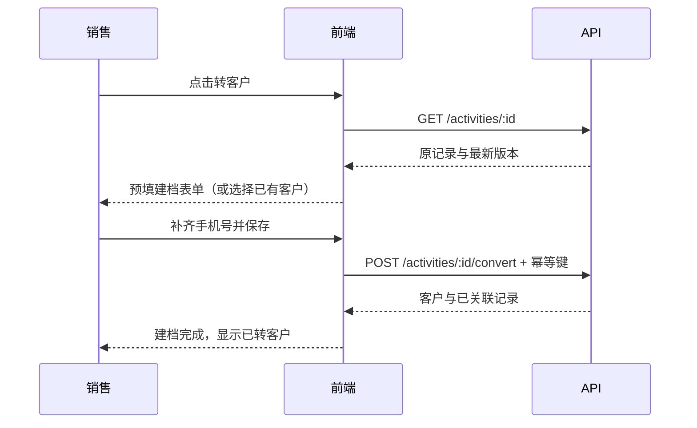

# 货代销售工作台 · 前端技术文档

> 这是保留的 v1.1 设计基线。已完成内容及验证范围见 [实施状态](../implementation-status.md)，实际代码以本仓库为准。

版本：v1.1 · 2026-11-11 · 状态：建议开发基线；不是已交付功能清单。

配套：[文档入口与实施顺序](README.md) · [后端技术文档](backend-technical-design.md)。

## 1. 目标、依据与边界

将四份静态设计实现为公司员工使用的销售工作台，覆盖“接触记录 → 转客户 → 跟进 → 阶段管理 → 工作台查看”的完整流程。还原设计的品牌、布局、信息层级与主要交互；将单机演示数据替换为真实登录用户、后端接口和多用户数据权限。

设计目录：`/Users/wangchi/Desktop/workbuddy/freight-forwarder-design/design/workbench/`。`index.html`、`customers.html`、`leads.html`、`call-records.html` 是页面依据，`workbench.css` 是视觉依据，`app.js` 是枚举与原型行为依据。逐项源码核对完成，尚未做浏览器视觉验收。

本系统是独立销售应用，不把现有 `frontend/` 公开时效系统或 `backend/` 运输管理系统直接改成 CRM。现有项目可复用依赖选择与通用模式；不得照搬其全量快照、单管理员或公开数据权限。

一期补充登录、改密、账号/团队管理、客户转交、归档恢复和审计查看等必要页面；这些页面没有现成设计，应沿相同视觉体系实现。首页走货图一期为明确“待接入”状态，真实票量接入为独立后续任务。自动拨号、录音、AI、报价附件发送、订单系统、消息推送、导入导出不在一期。

## 2. 技术选择与工程结构

| 层次       | 建议选择                                               | 目的                                          |
| ---------- | ------------------------------------------------------ | --------------------------------------------- |
| 运行与构建 | Node.js 24 LTS、npm 锁文件、Vite                       | 与既有服务的技术方向一致；实施时锁定确切版本  |
| 页面       | React 19、TypeScript strict                            | 组件复用与接口类型检查                        |
| 组件       | Ant Design 5、对应 React 19 兼容适配、Ant Design Icons | 表单、抽屉、表格、日期、确认框、无障碍基础    |
| 路由       | React Router                                           | 深链接、详情抽屉、登录回跳、浏览器返回        |
| 数据请求   | TanStack Query、原生 fetch                             | 服务端数据缓存、请求取消、失效刷新            |
| 校验       | 与服务端共用的 Zod schema                              | 字段、枚举、错误码统一                        |
| 图表       | Recharts                                               | 自适应柱状图与环形图，配文字数据说明          |
| 日期       | dayjs + utc/timezone                                   | 统一 Asia/Shanghai 展示与边界                 |
| 样式       | CSS 变量 + CSS Modules + Ant Design 主题               | 还原原型；不照搬整份全局 CSS 导致组件互相覆盖 |
| 验证       | Vitest、React Testing Library、Playwright              | 状态分支、真实接口联调、桌面与手机验收        |

这些是建议技术栈，不宣称已安装或搭建。延续已用的主要版本，开发初始化时检查兼容性、固定锁文件；不在本文臆定未来补丁版本。

未来建议目录（本轮不创建应用代码）：

```text
workbench/
  src/
    app/                 路由、Providers、身份边界、错误边界
    layouts/             WorkbenchLayout、Sidebar、Topbar、MobileNav
    features/
      auth/              登录、退出、改密
      dashboard/         KPI、阶段分布、提醒、走货占位
      customers/         列表、表单、详情、跟进、阶段、转交、归档
      activities/        快速录入、今日列表、全部记录、转换
      administration/    用户、团队、审计
    components/          徽章、来源标签、空态、错误态等
    api/                 fetch封装、错误映射、query keys
    styles/              tokens.css、基础样式
  shared/                DTO、Zod schema、枚举、错误码
  server/                后端模块，详见后端文档
  database/              独立CRM迁移
  tests/e2e/             隔离测试数据与验收流程
  docs/                  本组文档及后续变更记录
```

业务真值在服务端。筛选在路由/页面状态中，表单在 Ant Design Form 中；不另引入全局状态库复制所有客户对象。仅侧栏折叠等非敏感偏好允许 localStorage 持久化，客户资料、手机号、Cookie、访问令牌不得放入本地持久缓存。未提交表单只保留当前内存，刷新会丢失，离开前提醒。

## 3. 路由与导航

| 路由                                 | 页面/用途        | 参数及行为                                                                                               |
| ------------------------------------ | ---------------- | -------------------------------------------------------------------------------------------------------- |
| `/login`                             | 登录             | 成功回到已校验的同站 `returnTo`；不允许站外跳转                                                          |
| `/change-password`                   | 首次/主动改密    | 强制改密时只能进入本页或退出                                                                             |
| `/`                                  | 工作台           | 默认本人范围；主管/管理员可选择授权范围                                                                  |
| `/customers`                         | 客户列表         | `status` 或 `statusGte`、`source`、`sort`、`reminder=due_soon`、`page`、`pageSize`、`archived`、授权范围 |
| `/customers/:id`                     | 客户详情抽屉     | 刷新仍可打开；关闭返回原列表及筛选                                                                       |
| `/customers/new`                     | 新增客户抽屉     | 普通建档；可带 `fromActivityId` 进入转换模式                                                             |
| `/customers/:id/edit`                | 编辑抽屉         | 读取详情最新版本，成功后刷新详情和列表                                                                   |
| `/leads?tab=call\|visit`             | 电销·扫楼        | 枚举统一；同时兼容原型中文 tab 并规范化                                                                  |
| `/call-records`                      | 全历史接触记录   | `types`、`results`、`nextJudges`、`dateFrom`、`dateTo`、`page`、`pageSize`、授权范围                     |
| `/call-records/:id`                  | 接触记录详情抽屉 | 展示完整备注、转客户入口及管理员更正入口；关闭回原列表                                                   |
| `/settings/users`、`/settings/teams` | 员工/团队        | 管理员入口                                                                                               |
| `/settings/audit`                    | 审计查看         | 管理员入口；服务端检查权限                                                                               |

`/customers/new` 必须优先于动态 ID 路由匹配。搜索关键词可能含手机号，不放入浏览器地址、返回地址或浏览历史；页面内搜索可保留，刷新后清空。后端 GET 查询仍会携带关键词，因此反向代理和应用日志必须去掉完整查询字符串，见后端文档。

旧原型 URL 在入口适配：`customers.html?id=` → 新详情；`?status=已开户` → 精确状态，首页“开户客户”下钻改用 `statusGte=opened`；`leads.html?tab=call/visit/电销/扫楼` 均映射正确。无需继承带电话、姓名的旧预填链接；转化只传活动 ID。登录过期回跳保留非敏感路径和筛选，不持久化未提交资料。

## 4. 设计还原规范

| 设计项     | 正式基线                                                               |
| ---------- | ---------------------------------------------------------------------- |
| 品牌色     | 主色 `#185492`；深蓝 `#0D3B68`；亮蓝 `#2E7BC4`；浅蓝 `#EEF4FB`         |
| 背景与边框 | 页面 `#F5F7FA`；卡片白；边框 `#E3E8EF`；弱边框 `#EEF1F6`               |
| 文字       | 主 `#1F2733`；次 `#5A6675`；弱 `#8A95A3`，小字号必要时加深以满足对比度 |
| 状态徽章   | added 蓝、opened 橙、shipped 绿；圆点 + 图标 + 文案，不能只靠颜色      |
| 来源标签   | 灰底 `#EFF2F6` + 来源色圆点，沿原型七种来源色                          |
| 圆角       | 卡片12px、控件8px、标签6px、徽章胶囊                                   |
| 字体       | PingFang SC/微软雅黑/系统字体；数字 SF Mono/Menlo + tabular-nums       |
| 尺寸       | 侧栏220px，折叠64px；顶栏56px；内容最大1440px；桌面内边距20px 24px     |
| 字号       | 页面标题22px、正文14px、表格13px、KPI34px；数字统一深蓝                |
| 抽屉/弹窗  | 详情及编辑660px，平板580px；确认框430px，窄屏留边距                    |
| 动效       | hover/展开约150–280ms；尊重 reduced-motion，减少动效不减少反馈         |

响应式断点以实际 CSS 为准：`>1024px` 桌面；`769–1024px` 折叠侧栏及单列主内容；`≤768px` 手机底部四 Tab，侧栏隐藏、顶栏52px、内容左右14px。手机抽屉宽100%、高约94dvh，上圆角16px，操作区固定并适配键盘与安全区。首页首个 KPI 跨两列，另两项各占一列。

手机客户表和历史记录表均转卡片，不能仅隐藏桌面表。底部导航加安全区，内容预留至少120px底部空间；FAB 不遮住最后一条记录或提交按钮。首页 FAB 展开新增客户/开始电销/开始扫楼，客户页 FAB 直接新增；录入和历史页不叠加无关 FAB。

历史记录页四张统计卡桌面4列、手机2×2，不继承首页“第一张跨两列”的规则，也不保留原型内联四列样式；320px宽度下标签可换行，数量不能挤出卡片。

## 5. 工作台页面

### 5.1 数据和口径

页面调用 `GET /api/v1/dashboard`，由服务器返回聚合和统计时间，前端不下载全部客户再统计。顶部显示登录员工姓名和角色，替换原型固定“小罗”；切换范围清空旧范围缓存并重新加载。

| 模块         | 正式口径                                  | 点击行为                                    |
| ------------ | ----------------------------------------- | ------------------------------------------- |
| 总客户       | 当前范围未归档客户                        | 客户列表全部状态                            |
| 开户客户     | 当前状态 opened + shipped                 | `statusGte=opened`，不能仅筛 opened         |
| 走货客户     | 当前状态 shipped                          | `status=shipped`                            |
| 客户状态分布 | added/opened/shipped 三组互斥数量         | 对应精确状态列表                            |
| 今日电销     | 上海自然日 call 记录数及 contact_added 数 | 历史记录页附类型/结果及服务端定义的当日范围 |
| 待跟进       | 全部逾期 + 今日 + 未来7天，按到期时间升序 | 点客户进详情，更多入口带提醒筛选            |
| 走货量       | 未接入时无数字；接入后按真实销售票统计    | 一期无虚假的明细入口                        |

今日转化率是“成功添加联系方式数 / 电销记录数”，不是建档转化率；无电销时显示 `—` 与“暂无电销记录”。阶段分布保留原型三行图形，标题改为“客户状态分布”，不宣称是历史累计漏斗。率值由后端返回，前端只格式化。

待跟进默认展示前4条，同时显示全部符合条件的数量。逾期几周的客户也必须出现；未安排日期不当作1970年，也不纳入到期待办。时间上界为上海今天之后第8日00:00，不包含该时刻，即包含全部逾期、今日及未来7个自然日。更多入口统一使用 `reminder=due_soon`，列表显示可移除的“近期及逾期待跟进”筛选条，清除筛选时一并移除。提醒时间以服务器时间为准，跨天刷新时重新请求。

### 5.2 走货量状态

`dataStatus=not_connected`：显示“走货量待接入”，说明需要销售票来源，不绘制假柱、不填0。`ready` 且无票时才显示0；接口失败显示错误及重试，不伪装待接入。

后续接入的展示契约：本周周一至周日7个桶，本月按与自然月相交的周分4–6桶，仅统计月内日期。高亮依据返回日期等于今天，不固定最后一柱。未来日期不显示为已完成业绩。当前一期不提供票量录入或修改入口。

## 6. 客户管理页面

### 6.1 列表

搜索匹配名称、联系人、主电话；300ms 防抖，取消旧请求。状态/来源分别单选，各组条件 AND；`status` 与 `statusGte` 互斥。排序为最近跟进降序 `lastFollowAt:desc`、下次跟进升序 `nextFollowAt:asc`、阶段顺序 `status:asc`（added→opened→shipped），空日期末尾，服务端加 ID 保证稳定。筛选变化回到第1页；默认20条，最大100条。

桌面列依次为名称/联系人/高意向、状态、来源、主电话、最近跟进、提醒、操作。电话等宽；长名称省略但可展开。行点击开详情，编辑/归档按钮停止冒泡；键盘可聚焦明确的“查看客户”链接。手机显示同等关键信息和操作，不能只在 hover 时显示按钮。

归档记录通过 `archived=true` 独立视图查看（主管/管理员）；恢复入口不混在普通销售列表里。无客户显示新增入口；筛选无结果显示清除筛选；无权限、加载失败、暂时失去连接分别提示。

### 6.2 建档/编辑字段

以下长度为正式建议新增约束，原型未设完整长度限制。前后端共用同一 schema。

| 字段         | 控件/默认               | 校验                                          |
| ------------ | ----------------------- | --------------------------------------------- |
| `name`       | 客户名称输入            | 必填，去首尾空白，1–200字                     |
| `contact`    | 联系人输入              | 可空，≤100字                                  |
| `phone`      | 手机输入，inputMode=tel | 必填，去空白后 `^1[3-9]\d{9}$`，一期沿原型    |
| `altPhone`   | 备用电话                | 可空，≤50字；允许座机，不套主手机号规则       |
| `wechat`     | 微信号                  | 可空，≤100字                                  |
| `email`      | 邮箱                    | 可空，有值时校验格式，≤254字                  |
| `source`     | 7项来源 Chips           | 必填，普通建档默认call，扫楼转化默认visit     |
| `status`     | 状态徽章/独立操作       | 建档固定added，不能在普通编辑PATCH里暗改      |
| `address`    | 地址输入                | 可空，≤500字                                  |
| `needs`      | 主营/需求多行           | 可空，≤2000字                                 |
| `note`       | 备注多行                | 可空，≤4000字                                 |
| `highIntent` | 高意向开关              | 默认false                                     |
| `ownerId`    | 负责人展示              | 普通销售由会话确定；主管/管理员走独立转交操作 |

提交校验定位首个错误，保留所有已填项。主电话失焦后请求 `/customers/duplicate-check`；只显示有权访问的重复客户摘要，可查看/改号/继续创建，不阻断提交。不提示无权查看客户是否存在。编辑排除当前客户 ID；不在前端把电话唯一化。

提交中禁用按钮；成功才关闭抽屉并刷新列表。失败保留输入；409显示“资料已被更新”，允许查看最新内容后重新编辑，不能自动覆盖。关闭、切路由、切换员工身份前提示未保存修改；页面刷新使用浏览器离开提示，不承诺恢复草稿。

### 6.3 详情、跟进与状态

详情展示全部资料、真实负责人、创建时间、版本及最新在前的跟进时间线。详情与时间线分开按需加载，后者分页，不能在客户列表响应塞入全部历史。空字段显示 `—`。

跟进动作：greeting 正常问候、quote 发报价表、inquiry 客户询价、order 客户下单。内容必填≤4000字；发生时间由服务器生成，一期不开放回填历史时间。下次跟进使用日期选择，明确说明“按公司时间当天上午10:00提醒”；发送带 `+08:00` 的 ISO 时间，不依赖电脑时区。

下次提醒提供“保持原安排 / 设置日期 / 取消安排”三种明确选择，分别对应省略 `nextFollowAt`、具体时间、`null`。不能因表单留空意外取消或保留提醒；新日期不得早于公司当天。

`order` 只提议升一级；弹窗三选：“仅记录跟进”“升级并记录”“返回编辑”。前两者提交不同 payload，返回编辑不提交。升为 shipped 时文案要求确认实际已走货，“客户下单”本身不算走货事实。跟进与选定升级在同一请求原子提交；不先改状态再另存跟进。

独立阶段变更入口支持 added→opened→shipped 逐级确认；回退仅主管/管理员，必须填原因并再次确认。历史客户初录也先added，再按步核实阶段。归档与恢复确认框均要求填写1–500字原因；归档说明数据保留、普通列表隐藏，恢复后原有历史与关联均保留。转交从 `GET /assignees` 选择目标员工并填原因，提交后重新判断当前员工可见性，失去权限时关闭详情并清理缓存。

转交候选只含授权范围内启用员工；归档客户的原负责人已停用时，主管/管理员先转交再恢复。不能把“恢复成功”显示在负责人校验失败之前。

## 7. 电销·扫楼页面

### 7.1 快速录入

保持“先选结论”的设计：类型 Tab → 沟通结果 → 下次判断 → 名称/电话/地址/备注 → 提交。电销与扫楼分别保留内存草稿；切换类型不会把隐藏地址、旧结果带到另一类型提交。

| 字段           | 电销call                           | 扫楼visit                    |
| -------------- | ---------------------------------- | ---------------------------- |
| `customerName` | 必填≤200字                         | 必填≤200字                   |
| `phone`        | 必填大陆手机                       | 可空；填写时同样校验大陆手机 |
| `address`      | 不显示，省略；服务端固定为空字符串 | 必填≤500字                   |
| `result`       | 电销6项之一                        | 扫楼5项之一                  |
| `nextJudge`    | 必填revisit/defer/reject           | 相同                         |
| `note`         | 可空≤4000字                        | 相同                         |

结果与中文映射必须从共享元数据读取：电销 unanswered未接通、invalid_number空号·停机、call_rejected已接通·拒绝、call_deferred已接通·暂缓、call_interested已接通·有意向、contact_added成功添加联系方式；扫楼 no_entry无人·未进门、visit_rejected已沟通·拒绝、visit_deferred已沟通·暂缓、visit_interested已沟通·有意向、contact_added成功添加联系方式。

选择结果后建议判断：拒绝→reject，暂缓→defer，其余→revisit。用户可覆盖；后端最终验证。保留原型“空号·停机默认可再访”为待核定业务规则，不据此触发任何自动行动。

提交使用 `POST /activities` 和幂等键。只有服务器成功后清空当前类型字段与结果，保留 Tab，刷新今日列表/徽章/统计；失败全部保留。今日列表为当前类型、上海今日、授权范围内记录，默认本人；最新在前，量大时分页。

### 7.2 转客户

只有 `contact_added` 且尚未关联客户的记录显示“转客户”。保存活动后提示“立即转客户 / 稍后”；选择稍后不修改转换状态。



预填在表单初始化后应用一次，避免新建抽屉初始化清空数据。用户改过的输入不得被后台刷新覆盖。扫楼缺电话时要求补齐；支持关联有权限的已有客户，重复电话只给候选，不自动合并。

新建转换默认归属原活动录入人。其账号停用时，主管/管理员必须选择一名启用且有权分配的负责人，再在mode=create请求顶层发送ownerId；普通销售不能指定他人。422 `OWNER_INACTIVE` 时保留表单并提示选择负责人；mode=link不改变已有客户归属。活动原录入人不会被覆盖。

跳转URL只放 `fromActivityId`。取消表单、失败、失去网络均不标已转。重复点击或重试必须复用本次幂等键；若另一人已转换，显示服务端现有结果，不重复新建。无法查看已关联客户时显示权限提示，不泄露其资料。

## 8. 电销记录页面

保留原HTML的桌面九列表格：时间、类型、名称、电话、地址、结果、下次判断、备注、转客户。移动端用卡片；长备注提供可点击展开，不能依赖 hover title。记录行或明确的查看链接打开 `/call-records/:id` 详情抽屉，展示全部字段。已转记录可进入有权限的客户详情；`contact_added` 且未转的记录在表格、手机卡片和详情提供“转客户”，保证选择“稍后”后跨天仍可完成建档。该入口属于正式版补充。

顶部四卡为授权范围内全历史总数、电销数、扫楼数、成功添加联系方式数，标注“全部记录统计”，不随下方搜索/筛选变化。列表单独显示“筛选结果N条”。“全部记录”卡清除所有列表筛选及搜索；其他卡清除旧列表条件再应用其预设，防止叠加出隐蔽条件。卡片和清除操作均保留scope/teamId/ownerId权限范围，不悄悄切换到另一位员工的数据。

类型、结果、下次判断为多选，参数为 `types/results/nextJudges`，用重复参数编码；同组OR、跨组AND，关键词匹配名称/电话/地址。改变类型时只保留兼容结果，移除不兼容项并说明。页面清除按钮重置所有条件。默认时间降序并由ID稳定排序，服务端分页20条；一期不新增日期分组。首页今日电销下钻携带 `dateFrom/dateTo`（带时区ISO时间，开始含、结束不含）并显示可移除的“今日”筛选条，取上海当日00:00至次日00:00。

默认仅新增与查看。历史记录发现录错，由管理员通过详情“更正记录”入口带原因与版本提交；保留原始审计，不提供永久删除。非管理员不显示更正按钮；服务端仍须拒绝越权调用。

## 9. 多员工账号与权限界面

| 角色    | 可见范围           | 主要操作                                 |
| ------- | ------------------ | ---------------------------------------- |
| sales   | 本人客户和接触记录 | 建档、编辑、跟进、逐步晋级、归档本人客户 |
| manager | 本团队             | 同上，团队客户转交、阶段回退、归档恢复   |
| admin   | 全公司             | 同上，员工/团队、历史接触更正、审计      |

默认进入本人视角；角色可访问的额外范围在下拉框明确显示。管理员在 `scope=company` 下可选 `teamId` 或 `ownerId`，主管 `scope=team` 固定自己团队；范围参数在客户、活动、summary和dashboard中一致传递。页面按钮可根据服务端能力控制，但不能以隐藏按钮代替服务端鉴权。统计、筛选候选、转交候选、客户选择器和去重均遵守同一范围。

管理员员工页包含列表、建账号、角色/团队、停用、重置临时密码；不开放自助注册。创建或重置成功的临时密码只展示一次，不写URL、日志或本地存储，需要求员工首次改密。若响应丢失，走重新重置流程，不能查询旧明文密码。停用展示待交接客户数并提供交接入口，但不因尚未交接阻止立即停用；服务器使现有会话立即失效，历史操作人仍可追溯。调组须展示客户/历史活动可见范围会随之变化及影响数量，再确认提交；团队统计明确为当前管理范围，不称历史团队业绩。

管理员团队页提供创建、改名、成员归属调整；不能删除仍有员工/历史归属的团队。审计页按时间/动作/对象筛选，分页只读，不显示密码、Cookie、完整请求体等敏感信息。手机号等业务值按服务器授权输出。

员工调组/停用前通过 `GET /users/:id/impact` 读取影响数量和版本；提交仍带expectedVersion。预览数量不保证提交时不变，服务器在事务内重查，冲突时保留输入并刷新影响说明。

## 10. API接入与状态约定

同域 `/api/v1`，fetch带 `credentials: 'same-origin'`；生产不跨域调用另外两个旧站点。身份通过HttpOnly会话Cookie，不在JavaScript中管理登录令牌。写请求附服务端签发的CSRF值；登录流程及接口详见后端文档。

| 页面动作      | API（均加`/api/v1`）                                        | 成功后刷新                               |
| ------------- | ----------------------------------------------------------- | ---------------------------------------- |
| 恢复身份/字典 | `GET /auth/me`、`GET /metadata`                             | 身份与能力、枚举                         |
| 工作台        | `GET /dashboard`                                            | 当前范围聚合                             |
| 客户列表/详情 | `GET /customers`、`GET /customers/:id`                      | 列表/详情各自缓存                        |
| 建档/编辑     | `POST /customers`、`PATCH /customers/:id`                   | 客户列表、详情、dashboard、导航计数      |
| 电话软查重    | `POST /customers/duplicate-check`                           | 仅当前表单提示                           |
| 跟进          | `GET/POST /customers/:id/follow-ups`                        | 时间线、详情、列表、dashboard            |
| 阶段/负责人   | `PATCH /customers/:id/status`、`PATCH /customers/:id/owner` | 全部相关客户缓存及聚合                   |
| 归档/恢复     | `POST /customers/:id/archive`、`/restore`                   | 列表、详情、dashboard                    |
| 接触录入/历史 | `POST/GET /activities`                                      | 今日、历史、summary、dashboard、导航计数 |
| 接触统计/详情 | `GET /activities/summary`、`GET /activities/:id`            | 对应范围                                 |
| 转客户        | `POST /activities/:id/convert`                              | 活动、客户及相关聚合                     |
| 管理更正      | `PATCH /activities/:id`                                     | 活动、summary、dashboard                 |

统一成功响应 `{ data, meta: { requestId, serverTime, ... } }`，分页 `data` 为数组、`meta` 包含 `page/pageSize/total`。统一失败 `{ error: { code, message, fieldErrors? }, meta: { requestId, serverTime } }`。精确DTO、写入参数、错误码以后端文档为准；不得在前端发明另一个字段名。

查询键必须包含当前用户/授权范围、筛选和分页。个人信息接口 `Cache-Control: no-store`；TanStack Query只在内存缓存，不持久化。建议staleTime15秒、页面回焦刷新；写成功主动失效相关键。正在填写的表单不随轮询覆盖。退出/401/用户切换清空所有缓存与内存草稿。

| 情况          | 必须呈现的行为                                         |
| ------------- | ------------------------------------------------------ |
| 初次加载      | 对应区域骨架，不闪现演示数据                           |
| 结果为空      | 真空态或筛选空态，不显示错误Toast                      |
| 后台刷新      | 保留旧数据并显示刷新状态；失败标明数据未更新           |
| 401           | 清身份和缓存，进入登录；提示未提交内容不会被保存       |
| 403/404       | 操作无权限或记录不可访问；不要猜测他人记录是否存在     |
| 409           | 保留编辑内容，提示版本冲突或已被转换；需重新读取后处理 |
| 422           | 字段内提示并聚焦首错；其他字段不丢失                   |
| 429           | 按Retry-After提示稍后重试；不循环请求                  |
| 503/超时/离线 | 局部错误+手动重试，绝不回退localStorage演示数据        |

GET可有限自动重试（最多2次，仅网络/暂时性5xx）；写请求不盲目重试，人工重试复用原幂等键。若用户修改请求内容，生成新键。服务器返回成功前不能提前Toast“已保存”。日志只记录错误码和requestId，不记录客户资料或表单值。

## 11. 性能、可访问性与测试

性能是验收目标而非当前测量结果：按后端约定的模拟规模准备隔离数据；20Mbps/100ms往返的测试网络，首次可交互P75≤3秒，列表筛选从输入结束至结果P95≤2秒。客户端分路由加载，列表按页查询，详情按需请求，避免全量客户/接触记录下载。性能失败先用真实分析定位，不以虚拟空数据掩盖。

所有手机触控目标至少44×44px；图标按钮有可理解的名称；状态非纯色；键盘可打开行详情、切换筛选和提交。抽屉/弹窗有焦点陷阱，关闭后回归触发点，Esc遵守未保存提示；错误同时有文本和关联字段。遵守WCAG AA文字对比度；图表配文本数量，减少动效偏好有效。

| 验收编号 | 场景                                                  | 预期结果                                                   |
| -------- | ----------------------------------------------------- | ---------------------------------------------------------- |
| F01      | 1440/1024/768/390/320px查看四页                       | 无丢失记录、遮挡提交、整体横向溢出；对应设计布局           |
| F02      | 新客户、电话重复、邮箱错误                            | 双端同规，重复软提示，失败保留输入                         |
| F03      | 查看/编辑/跟进/设置及清除提醒                         | 成功后其他页面一致；空值语义明确                           |
| F04      | 下单：仅记录/升级并记录/返回                          | 三种行为独立，状态和跟进无半成功                           |
| F05      | 阶段回退、归档、恢复、转交                            | 角色边界正确，有原因及服务端审计                           |
| F06      | 转客户：取消、缺手机号、重试、并发、跨天从历史继续    | 只有建档事务成功才已转，最多一个关联；稍后处理不丢入口     |
| F07      | 开户KPI下钻                                           | 列表总数等于opened+shipped卡片值                           |
| F08      | 逾期两周、今日、跨月/周日                             | 提醒不丢；上海边界正确；待接入与0分开                      |
| F09      | 历史多选、搜索、清除、全量卡片                        | OR/AND规则、计数口径和分页正确                             |
| F10      | 401/403/404/409/422/429/503/离线                      | 遵循上一节状态表，无假保存或敏感缓存残留                   |
| F11      | 两名销售及主管、员工停用/调组、离职员工历史活动转客户 | 无越权资料，停用及时退出；新客户归属启用人员；调组影响明确 |
| F12      | 仅键盘、手机键盘、减少动效                            | 所有主要操作可完成，焦点和安全区正确                       |

组件测试聚焦校验、日期显示、抽屉/表单状态与请求分支；集成测试使用隔离API验证完整闭环；浏览器测试覆盖真实构建产物。视觉截图和差异核对以四页设计为依据，补充页保持同体系。至少验证Chrome/Edge桌面及iOS Safari/Android Chrome手机；以试点同事实际设备复核。

## 12. 发布与公司试点交付

前端产物由同一工作台服务或Nginx同域托管。静态资源带内容hash并长期缓存，入口HTML不长期缓存；SPA深链接刷新走index.html，`/api`错误不能被重写成HTML。生产构建不得包含演示种子、业务资料、凭据或源码映射中的敏感内容。发布路径、HTTPS和回滚见后端文档。

按文档入口M0–M6推进。上线前交付可点开的正式地址、个人账号开通方式、一页使用指引（登录→录电销/扫楼→转客户→跟进→工作台）、问题反馈方式。先由2–5位同事完成真实工作闭环，确认弱网及手机可用，再扩大推广；明确走货量尚待接入，不宣传自动外呼/录音等未提供能力。

本轮只交付技术文档，后续实现时按F01–F12记录实际通过证据及未解决项，不把本表当作测试已通过。
